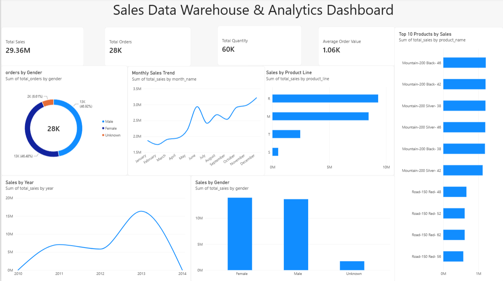
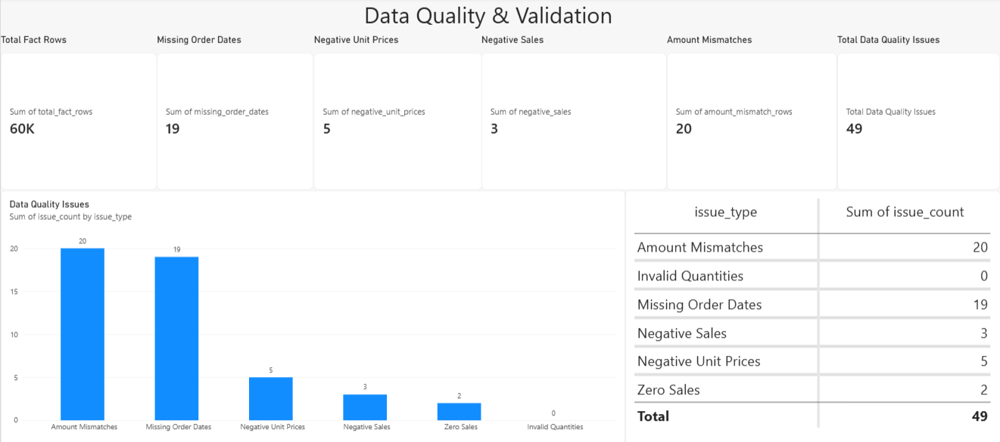
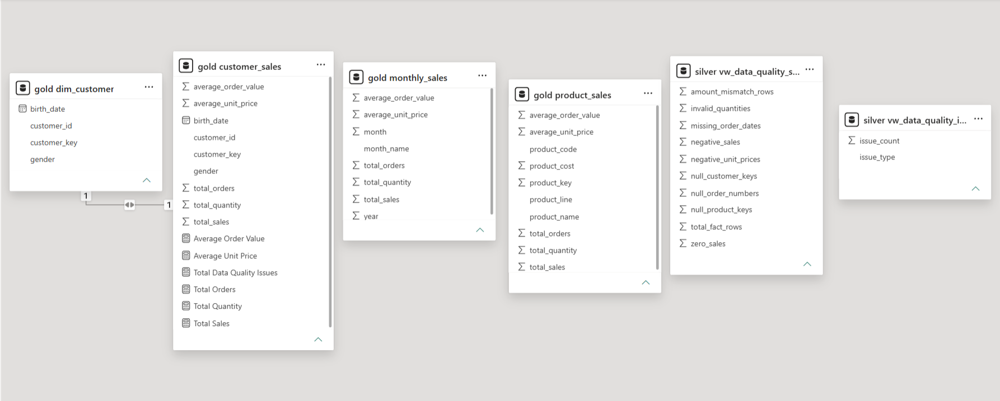

# 🚀 Sales Data Warehouse & Analytics Platform

> **End-to-end data warehousing and business intelligence solution built with SQL Server, T-SQL, dimensional modeling, data-quality validation, and Power BI.**

A production-style **Sales Data Warehouse & Analytics Platform** that transforms raw transactional data into structured, validated, analytics-ready datasets using a **Bronze → Silver → Gold architecture**.

The project combines **data engineering, dimensional modeling, SQL analytics, data-quality monitoring, and business intelligence** into a single end-to-end workflow.

---

# 🎯 What This Project Solves

Raw transactional datasets are often difficult to analyze directly because they can contain inconsistent values, missing dates, invalid prices, unmatched dimension references, and calculation discrepancies.

This project addresses that problem by building a layered warehouse that:

- Ingests raw sales, customer, and product datasets
- Separates raw, transformed, and analytical data
- Builds fact and dimension structures
- Performs data-quality and referential-integrity validation
- Creates reusable analytical SQL views
- Calculates business KPIs independently
- Produces analytics-ready Gold datasets
- Connects curated warehouse data to Power BI
- Provides dedicated **Sales Analytics** and **Data Quality** dashboards

---

# 🏗️ Architecture

```text
                    RAW SOURCE DATA
                          │
                          ▼
              ┌──────────────────────┐
              │       BRONZE         │
              │                      │
              │ Raw Source Tables    │
              │ Sales / Customer /   │
              │ Product Data         │
              └──────────┬───────────┘
                         │
                         ▼
              ┌──────────────────────┐
              │       SILVER         │
              │                      │
              │ Cleaned & Structured │
              │ Fact + Dimensions    │
              │ Data Validation      │
              │ Analytical Views     │
              └──────────┬───────────┘
                         │
                         ▼
              ┌──────────────────────┐
              │        GOLD          │
              │                      │
              │ Business-Ready       │
              │ Aggregations & KPIs  │
              └──────────┬───────────┘
                         │
                         ▼
              ┌──────────────────────┐
              │      POWER BI        │
              │                      │
              │ Executive Dashboard  │
              │ Data Quality Report  │
              └──────────────────────┘
```

---

# 📚 Dataset & Reproducibility

The project includes the **raw source datasets** used as the starting point for the warehouse pipeline.

### Raw Dataset Files

```text
datasets/
├── sales_details.csv
├── cust_az12.csv
└── prd_info.csv
```

These datasets represent the raw sales, customer, and product inputs used throughout the project.

The raw files are intentionally kept separate from the transformed warehouse layers so that the complete flow can be understood and reproduced:

```text
Raw CSV Data
     ↓
Bronze Layer
     ↓
Silver Layer
     ↓
Gold Layer
     ↓
Power BI Analytics
```

### Dataset Source

The raw datasets are sourced from the **DataWithBaraa SQL Data Warehouse Project** and are used as the source input for this implementation.

**Source Repository:**  
`DataWithBaraa/sql-data-warehouse-project`

The implementation in this repository focuses on the warehouse modeling, SQL transformations, data-quality validation, analytical views, KPI validation, Gold-layer analytics, and Power BI reporting built around these source datasets.

---

# 🧱 Data Warehouse Design

## Bronze Layer — Raw Data

The Bronze layer preserves source-level datasets before downstream transformations.

### Tables

```text
bronze.sales_details
bronze.cust_az12
bronze.prd_info
```

Purpose:

- Raw data ingestion
- Source preservation
- Initial staging
- Separation from transformed warehouse data

---

## Silver Layer — Core Warehouse

The Silver layer contains the structured warehouse model and validation logic.

### Core Tables

```text
silver.fact_sales
silver.dim_customer
silver.dim_product
silver.dim_date
silver.cust_az12
```

### Analytical & Validation Views

```text
silver.vw_sales_summary
silver.vw_sales_kpi
silver.vw_data_quality_summary
silver.vw_data_quality_issues
```

The Silver layer acts as the primary analytical foundation by combining transactional sales with customer, product, and date attributes.

---

# 🥇 Gold Layer — Analytics Ready

The Gold layer contains business-oriented datasets optimized for reporting and dashboard consumption.

```text
gold.customer_sales
gold.dim_customer
gold.monthly_sales
gold.product_sales
```

These datasets provide pre-aggregated business metrics for efficient Power BI reporting.

---

# 🧩 Dimensional Modeling

The warehouse follows **fact-and-dimension / star-schema concepts**.

### Fact

```text
silver.fact_sales
```

Contains transactional sales-level information such as:

- Order number
- Order date
- Product key
- Customer key
- Quantity
- Unit price
- Sales amount

### Dimensions

```text
silver.dim_customer
silver.dim_product
silver.dim_date
```

These dimensions provide descriptive context for analytical slicing and aggregation.

This separation enables analysis across dimensions such as:

- Time
- Customer
- Product
- Product Line
- Gender

---

# 🔍 Data Quality & Validation

Data quality is treated as a first-class part of the warehouse rather than being handled only at the visualization layer.

The project implements SQL-based checks for:

| Validation Check | Issues Found |
|---|---:|
| Missing Order Dates | 19 |
| Negative Unit Prices | 5 |
| Negative Sales | 3 |
| Zero Sales | 2 |
| Invalid Quantities | 0 |
| Amount Mismatches | 20 |
| **Total Quality Issues** | **49** |

### Referential Integrity

Additional validation confirmed:

```text
Orphan Product Keys → 0
Orphan Customer Keys → 0
Orphan Date Rows    → 0
```

The warehouse also includes an **Unknown / Unmatched Product** record to prevent unmatched product references from breaking downstream analytical joins.

---

# 📊 Power BI Analytics

## Executive Sales Dashboard

The first Power BI page provides an executive-level view of sales performance.

### KPIs

```text
Total Sales          → 29.36M
Total Orders         → 28K
Total Quantity       → 60K
Average Order Value  → 1.06K
```

### Visual Analysis

The dashboard includes:

- 📈 Monthly Sales Trend
- 📊 Sales by Product Line
- 🏆 Top 10 Products by Sales
- 👥 Sales by Gender
- 👤 Orders by Gender
- 📅 Sales by Year

### Dashboard Preview



---

## 🛡️ Data Quality & Validation Dashboard

A dedicated Power BI page exposes warehouse-quality issues instead of hiding them.

It monitors:

- Total Fact Rows
- Missing Order Dates
- Negative Unit Prices
- Negative Sales
- Zero Sales
- Amount Mismatches
- Invalid Quantities
- Total Data Quality Issues



---

## 🗺️ Power BI Data Model

The Power BI model connects the curated analytical datasets and validation views used by the reporting layer.



---

# 🧮 SQL Analytics Layer

The project includes reusable SQL scripts for validation, KPI verification, and analytical views.

## `04_Data_Quality.sql`

Contains validation queries for:

- Missing order dates
- Negative unit prices
- Negative sales
- Zero sales
- Invalid quantities
- Amount mismatches
- Referential-integrity checks

---

## `05_KPI_Validation.sql`

Independently validates the core metrics consumed by the Power BI dashboard, including:

- Total sales
- Total orders
- Total quantity
- Average order value

This provides an additional SQL-side validation layer for dashboard metrics.

---

## `06_Analytics_Views.sql`

Documents reusable analytical views:

```text
silver.vw_sales_summary
silver.vw_sales_kpi
silver.vw_data_quality_summary
silver.vw_data_quality_issues
```

These views provide a reusable semantic layer between warehouse tables and reporting.

---

# 🛠️ Technology Stack

| Area | Technology |
|---|---|
| Database | Microsoft SQL Server |
| Query Language | T-SQL |
| Data Warehouse | Bronze / Silver / Gold |
| Data Modeling | Fact & Dimension / Star Schema |
| Analytics | SQL Views & Aggregations |
| BI | Microsoft Power BI |
| Validation | SQL-based Data Quality Checks |
| Version Control | Git / GitHub |

---

# 📁 Project Structure

```text
SalesDataWarehouse/
│
├── datasets/
│   ├── sales_details.csv
│   ├── cust_az12.csv
│   └── prd_info.csv
│
├── PowerBI/
│   └── SalesDataWarehouse.pbix
│
├── SQL/
│   ├── 04_Data_Quality.sql
│   ├── 05_KPI_Validation.sql
│   └── 06_Analytics_Views.sql
│
├── Screenshots/
│   ├── 01_Executive_Dashboard.png
│   ├── 02_Data_Quality_Dashboard.png
│   └── 03_PowerBI_Data_Model.png
│
└── README.md
```

---

# 📈 Project Highlights

### Data Engineering

- Layered **Bronze → Silver → Gold** warehouse architecture
- Structured fact and dimension tables
- Source-to-analytics transformation workflow
- Analytics-ready Gold datasets

### Data Quality

- Automated SQL validation logic
- Referential-integrity checks
- Missing-value detection
- Negative-value detection
- Zero-value detection
- Calculation mismatch detection

### Analytics

- Reusable SQL analytical views
- Independent KPI validation
- Business-level aggregations
- Product, customer, gender, and time-based analysis

### Business Intelligence

- Executive KPI dashboard
- Sales trend analysis
- Product performance analysis
- Dedicated data-quality dashboard
- Power BI semantic/reporting layer

---

# 🎓 Key Learning Outcomes

This project provided hands-on experience with:

- SQL Server database development
- T-SQL querying and transformations
- Data warehouse architecture
- Bronze / Silver / Gold layering
- Fact and dimension modeling
- Analytical SQL views
- Data-quality engineering
- Referential-integrity validation
- KPI development and validation
- Power BI dashboard development
- SQL-to-BI reporting workflows
- Business-oriented analytical thinking

---

# 🚀 Future Enhancements

Potential extensions include:

- Automated ETL orchestration
- Incremental data loading
- SQL Server Agent scheduling
- Advanced Power BI drill-through
- Row-level security
- Automated data-quality alerts
- Scheduled Power BI refresh
- Profitability analytics
- Customer retention analysis

---

# 👨‍💻 Author

**Girish Jain**

B.Tech Computer Science & Engineering  
Delhi Technological University

---

## ⭐ Project Summary

> **A complete SQL Server + Power BI analytics workflow that converts raw transactional data into a layered, validated, business-ready data warehouse and interactive BI reporting solution.**